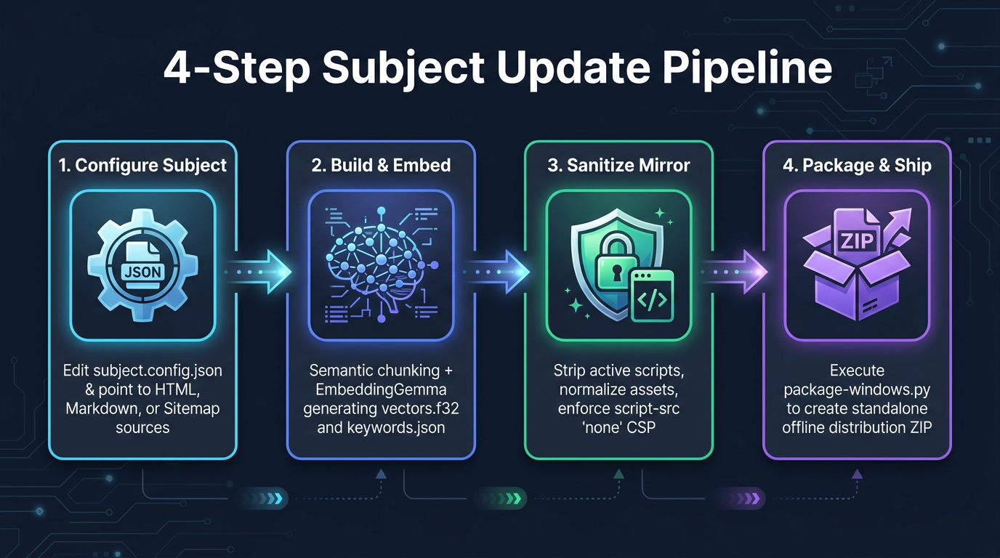

In the [first article](https://dev.to/gde/leveling-the-playing-field-building-a-100-offline-kubernetes-docs-rag-exam-assistant-with-web-ai-53bi), we built **[Kubernetes WebAI RAG](https://github.com/wongcyrus/kubernetes-webai-rag)**—a 100% offline, browser-based exam assistant powered by **Gemma 4 E2B**, **EmbeddingGemma**, **LiteRT-LM**, **TensorFlow.js**, and **WebGPU**.

That post covered *why* offline Web AI solves classroom equity and academic integrity, and *how* the browser runtime works under the hood (OPFS caching, hybrid BM25 + WebGPU vector search, and Windows 11 zero-config packaging).

Now comes the next practical question from educators:

> **"I don't teach Kubernetes. How do I adapt this for Python, Linux administration, cybersecurity, or my own course notes—and update it easily every semester without rebuilding the entire 2 GB model bundle?"**

That is exactly why we evolved the architecture into **[SourceDesk AI](https://github.com/wongcyrus/sourcedesk-ai)** (`sourcedesk-ai`): a universal offline RAG platform built around **replaceable subject packs** and **shared local models**.

### Demo: SourceDesk AI - Build a Private Course AI for Any Subject Offline



---

## 1. The Core Insight: Fixed Runtime vs. Swappable Subject Cartridge

When you strip away the Kubernetes branding, the system splits cleanly into two independent layers:


### 1. The Fixed Universal Runtime (Built Once, Shared Across All Courses)
- **`src/CosineSimilarity.js`**: Loads any normalized `vectors-<hash>.f32` matrix into WebGPU and runs `tf.matMul` + `tf.topk` in milliseconds.
- **`src/KeywordSearch.js`**: Runs BM25 + Reciprocal Rank Fusion (RRF) over any `keywords-<hash>.json`.
- **`src/OfflineAnswerGenerator.js`**: Streams grounded answers from **Gemma 4 E2B** (`~2.01 GB`) with atomic **OPFS** caching.
- **Shared Model & Windows Runtime (`package:common` / `package:app`)**: Bundles Python 3.14.4 embeddable, `EmbeddingGemma 300M`, and `Gemma 4 E2B` once.

### 2. The Swappable Subject Pack (Lightweight, Course-Specific)
Everything that changes between courses lives in a self-contained subject pack:
- **Source Documentation**: HTML, Markdown (`.md`), PDF (`.pdf`), or Word (`.docx`) course materials.
- **Prebuilt Index**: `vectors-<hash>.f32` + `keywords-<hash>.json` + chunk metadata.
- **Sanitized Local Mirror**: Offline HTML pages + local assets with `script-src 'none'` CSP.
- **Subject Manifest**: Course title, domain prompt instructions, and sample questions.

Because the **2+ GB AI models never change between subjects**, students who already have the shared runtime cached in their browser's OPFS on `localhost:8080` only need to swap in the lightweight subject pack!

---

## 2. Multi-Format Ingestion: Beyond HTML Sitemaps

In the original Kubernetes prototype, `build-kubernetes.mjs` was hardcoded to scrape a single `/_print/` HTML page and XML sitemap. Real-world courses rarely look like that—educators have **Markdown lecture notes, PDF textbooks, DOCX lab manuals, and static doc sites**.

In **SourceDesk AI**, [`scripts/build-subject.mjs`](https://github.com/wongcyrus/sourcedesk-ai/blob/main/scripts/build-subject.mjs) unifies ingestion across formats:
- **HTML & Static Sites** (`linkedom`): Crawls local HTML snapshots or sitemaps, preserving heading structure.
- **Markdown** (`markdown-it` via `scripts/markdown-source.mjs`): Converts `.md` files into clean semantic HTML with heading anchors (`<h2 id="...">`).
- **PDF & DOCX** (`pdfjs-dist` & `mammoth` via `scripts/document-source.mjs`): Extracts structured sections from textbooks, syllabi, and lab sheets into HTML pages.

> **Why convert everything to semantic HTML with heading anchors?**  
> Because it powers the side-by-side verification reader! When a student clicks `[1]` in an answer, the browser opens the exact local HTML page and scrolls straight to the `#heading-anchor` inside the sandboxed `<iframe>`.

---

## 3. The 4-Step Workflow to Add or Update a Subject

Once your course materials are ready, building, verifying, and shipping a new subject pack takes four commands:



### Step 1: Configure & Prepare Your Subject Source
Place your course docs (Markdown, PDF, DOCX, or HTML) in `examples/<id>/content/` and define `examples/<id>/subject.json` (plus `evaluation.json` for retrieval checks). For example, our **[Linux Command Line](https://github.com/wongcyrus/sourcedesk-ai/blob/main/examples/linux-commands/subject.json)** pack uses open-source `tldr-pages` Markdown files.

### Step 2: Build the Subject Index (`build:subject`)
Run the unified subject builder with the path to `subject.json` to chunk by headings, compute 768-dimensional `EmbeddingGemma` vectors, and generate the BM25 keyword index:

```bash
npm run build:subject -- --subject examples/linux-commands/subject.json
```

This outputs the content-hashed `vectors-<hash>.f32` matrix and `keywords-<hash>.json` postings into `data/linux-commands/`.

### Step 3: Evaluate Retrieval Quality (`test:retrieval`)
Before handing a new subject pack to students, run automated retrieval checks against `evaluation.json` to verify that your chunking and hybrid search surface the right passages:

```bash
npm run test:retrieval -- data/linux-commands examples/linux-commands/evaluation.json
```

### Step 4: Sanitize, Package, and Activate (`prepare:offline` & `package:subject`)
Sanitize the local HTML mirror (stripping `<script>`, `<form>`, `<iframe>`, and enforcing `script-src 'none'` CSP), activate the pack locally, and package **only the subject pack** (or one-click Windows `.cmd` installers) for students:

```bash
npm run prepare:offline
npm run activate:subject -- --pack data/linux-commands
npm run package:subject -- data/linux-commands
```

Students can then install or switch to the **Linux Command Line** pack with a single click—reusing the shared 2 GB Gemma 4 / EmbeddingGemma runtime:
- **One-Click Student Installer**: [Install-linux-commands-b43fdf502b353eb1-RAG.cmd](https://github.com/wongcyrus/sourcedesk-ai/releases/download/v0.2.2/Install-linux-commands-b43fdf502b353eb1-RAG.cmd)
- **Classroom Installer (Offline Common)**: [Classroom-linux-commands-b43fdf502b353eb1-RAG.cmd](https://github.com/wongcyrus/sourcedesk-ai/releases/download/v0.2.2/Classroom-linux-commands-b43fdf502b353eb1-RAG.cmd)

---

## 4. Why This Matters for Classroom Operations

Separating the **shared model runtime** from **subject packs** solves three real-world headaches for IT teams and instructors:

1. **Fast Semester Updates**: Updating a typo in a lab manual or adding a new lecture only requires regenerating the small subject pack—not re-downloading 2 GB of LLM weights.
2. **Multi-Course Lab Machines**: A single university lab PC can host multiple subjects (e.g., *Intro to Python*, *Linux Admin*, *Cloud Security*) sharing one `Gemma 4 E2B` OPFS cache on `localhost:8080`.
3. **Consistent Grounding & Safety**: Every subject automatically inherits the same prompt-injection defenses, inert `markdown-it` rendering, and strict CSP sandboxing.

---

## Conclusion

By decoupling the **universal WebGPU + Gemma 4 runtime** from **replaceable subject packs**, **[SourceDesk AI](https://github.com/wongcyrus/sourcedesk-ai)** turns an offline Kubernetes exam assistant into a reusable platform for any technical curriculum.

- **One runtime**, unlimited subjects.
- **Supports HTML, Markdown, PDF, and DOCX** out of the box.
- **1-command subject switching** with zero changes to the browser engine or cached models.

### Explore the Project
- **SourceDesk AI (Universal Platform)**: [github.com/wongcyrus/sourcedesk-ai](https://github.com/wongcyrus/sourcedesk-ai)
- **Part 1 (Architecture & Classroom Equity)**: [Leveling the Playing Field: Building a 100% Offline Kubernetes Docs RAG Exam Assistant](https://dev.to/gde/leveling-the-playing-field-building-a-100-offline-kubernetes-docs-rag-exam-assistant-with-web-ai-53bi)

**Suggested Tags:** `WebAI`, `RAG`, `Gemma`, `WebGPU`, `EdTech`
